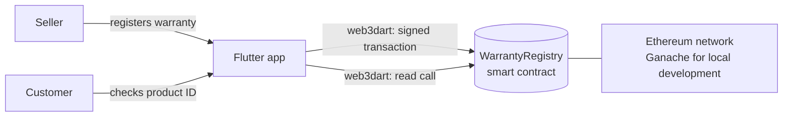

# Digital Warranty App

A cross-platform Flutter app that stores product warranties on an Ethereum blockchain, so warranty records are tamper-proof and can be verified by anyone with the product ID.

Paper warranty cards get lost, and shop records can be edited or disputed. This app gives sellers and customers one shared, permanent record: a seller registers the warranty at the point of sale, and the customer can check its status at any time.

## Features

- **Two roles:** separate seller and customer flows from a role-selection screen.
- **Register warranties (seller):** product ID, product name, customer name, purchase date and a warranty period of 6 months, 1, 2 or 3 years.
- **Check warranties (customer):** look up a product ID to see its details, expiry date and whether it is still **Valid** or **Expired**.
- **On-chain records:** each warranty is written to a Solidity smart contract through a signed transaction, so it cannot be edited afterwards.
- **Duplicate protection:** the contract rejects a product ID that is already registered.

## How it works



1. The seller fills in the registration form and submits it.
2. The app calls `registerWarranty` on the `WarrantyRegistry` contract with a signed transaction.
3. The customer enters a product ID; the app calls `checkWarranty` and calculates the expiry date and status from the stored purchase date and period.

## Tech stack

| Layer | Technology |
|---|---|
| Mobile / desktop app | Flutter, Dart |
| Blockchain access | web3dart, http |
| Smart contract | Solidity 0.8 |
| Contract tooling | Hardhat, ethers.js, dotenv |
| Local blockchain | Ganache |

## Project structure

```
lib/
  models/warranty.dart              Warranty model, expiry and validity logic
  services/blockchain_service.dart  Talks to the smart contract
  screens/                          Role selection, login, register and check screens
warranty-blockchain/
  contracts/WarrantyRegistry.sol    The smart contract
  scripts/deploy.js                 Deployment script
  hardhat.config.js                 Network settings (reads .env)
config.example.json                 Template for the app's blockchain settings
```

## Getting started

### Prerequisites

- [Flutter SDK](https://docs.flutter.dev/get-started/install)
- [Node.js](https://nodejs.org/) (an LTS version)
- [Ganache](https://archive.trufflesuite.com/ganache/) running on `http://127.0.0.1:7545`

### 1. Deploy the smart contract

```bash
cd warranty-blockchain
npm install
cp .env.example .env        # Windows PowerShell: copy .env.example .env
```

Open `.env` and set `PRIVATE_KEY` to the private key of a Ganache account (key icon next to the account). Then deploy:

```bash
npx hardhat run scripts/deploy.js --network ganache
```

Copy the address printed after `WarrantyRegistry deployed to:`.

### 2. Configure the app

From the project root:

```bash
cp config.example.json config.json   # Windows PowerShell: copy config.example.json config.json
```

Fill in `config.json`:

| Key | Value |
|---|---|
| `RPC_URL` | `http://127.0.0.1:7545` when running on the same computer as Ganache; your computer's local IP (e.g. `http://192.168.x.x:7545`) when running on a phone |
| `PRIVATE_KEY` | The same Ganache private key used in `.env` |
| `CONTRACT_ADDRESS` | The address from the deploy step |

`config.json` and `.env` are listed in `.gitignore` and must never be committed.

### 3. Run the app

```bash
flutter pub get
flutter run --dart-define-from-file=config.json
```

## Limitations and next steps

This is a learning project built for local development. Known limitations, and how a production version would address them:

- **Transaction signing:** the app signs transactions with a key supplied at build time. A production app would sign on a backend service or through the user's own wallet (e.g. WalletConnect), because any key bundled into an app can be extracted.
- **Login:** the seller and customer login screens are a demo flow and do not yet verify credentials.
- **Validity check:** the expiry status is calculated in the app; it could also be enforced inside the smart contract.
- **Customer warranty list:** the "My Warranties" screen is a placeholder.
- **Tests:** the contract and app need automated tests.

## Author

**Djeinaba Issa Wadou**: [Portfolio](https://djeinaba-portfolio.onrender.com) · [GitHub](https://github.com/djeinaba-issa-wadou) · [LinkedIn](https://www.linkedin.com/in/djeinaba-wadou-138a29178)
